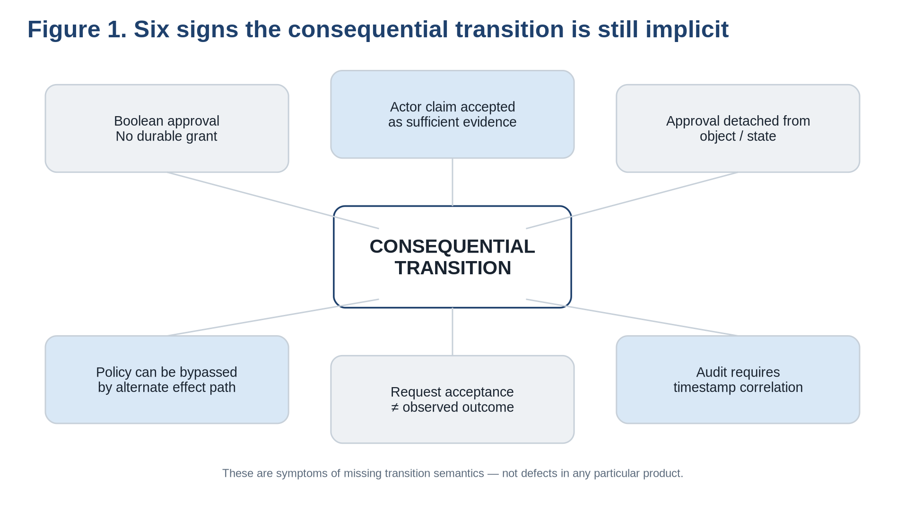
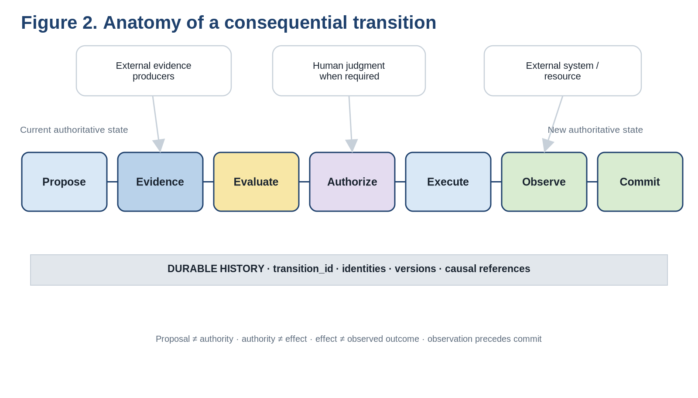
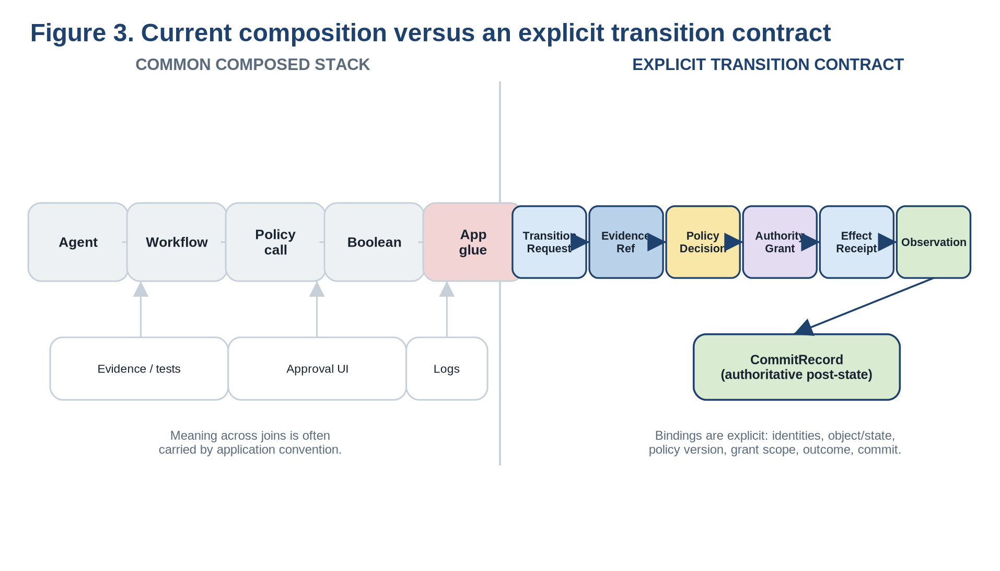
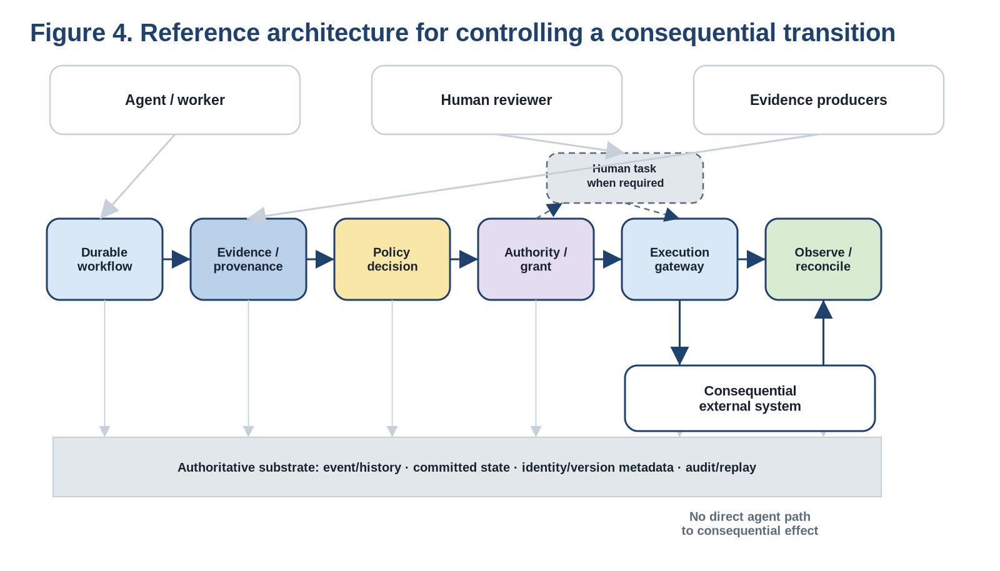
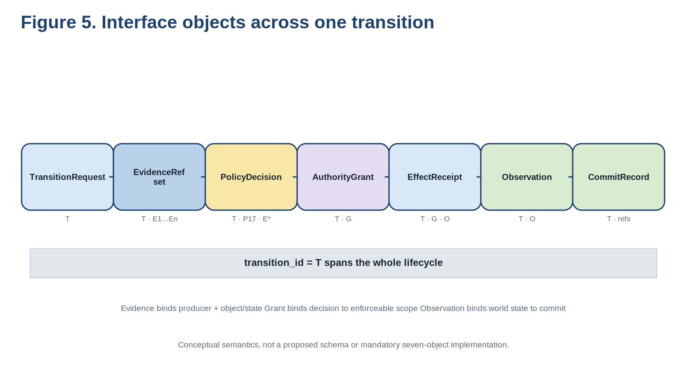
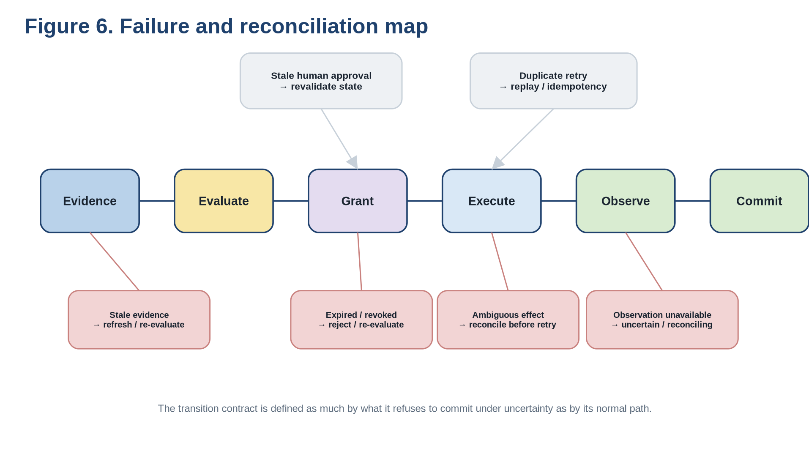
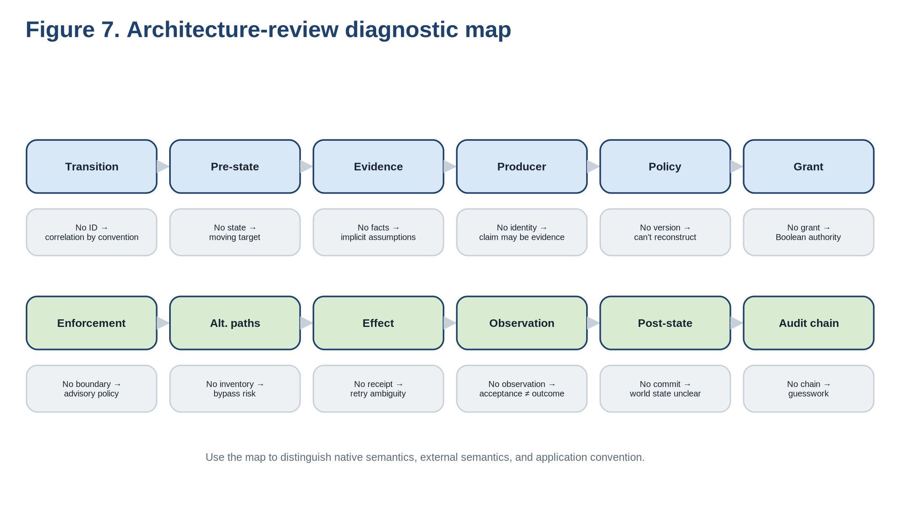
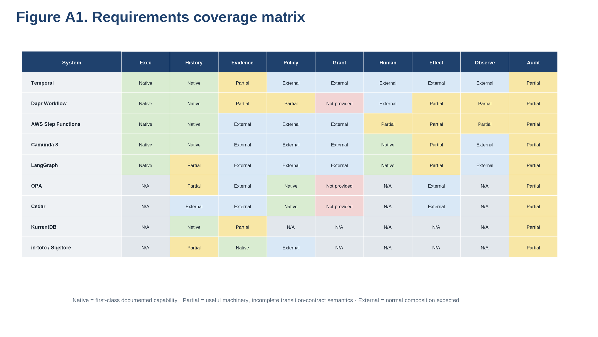
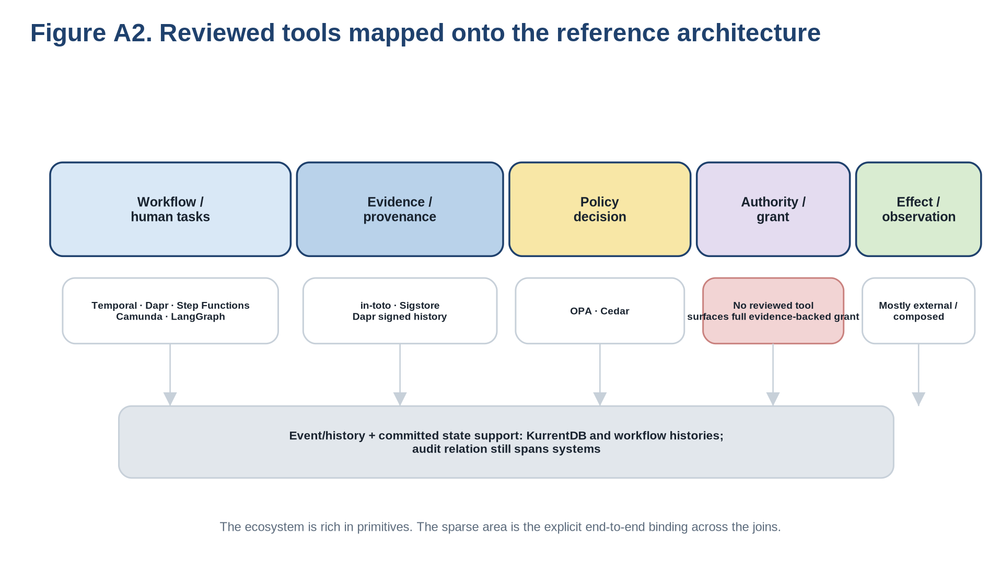

# Controlling Consequential Transitions

*An Execution Contract and Architecture-Review Method for Agent Workflows*

**Author and collaboration**

Brad Pierce in collaboration with an AI language model.

**Contribution statement**

Brad Pierce developed the central formulation and retains final editorial responsibility. AI assisted in preparing the paper. This collaboration does not imply endorsement by any organization.

### Abstract

“Agents Act. Systems Remember. Rules Authorize. People Govern.” separates productive work, trusted evidence, authorization, and human decision points [1]. This paper asks what execution contract makes those separations enforceable in software. It treats the consequential state transition as the unit of control: evidence is gathered, policy evaluated, scoped authority granted, effects executed, outcomes observed, and authoritative state committed under one reconstructable identity. Existing workflow, policy, provenance, event-history, human-task, and agent-checkpointing systems already provide most of the required primitives. In the systems reviewed here, however, the complete evidence → policy → authority → effect → observation → commit relation is not first-class across product boundaries. The paper derives fourteen requirements and a reference architecture that make this relation explicit and testable, with bounded authority, enforcement at the real effect boundary, independent observation, and reconstructable history. The contract can be realized by composition, a protocol/profile, or an integrated runtime. This is a design sketch rather than an implementation result; its failure-oriented acceptance tests define the proposed validation surface.

## 1. Recognize the problem

Many stacks already contain a workflow engine, agent framework, policy check, audit log, approval mechanism, and a collection of external tools. Yet the path from “the agent proposes something” to “the world changed” may still depend on application conventions that are hard to inspect and easy to bypass.

The problem often shows up through small engineering smells.

A workflow reaches an “approved” node, but there is no durable object that says who may do exactly what, to which resource, under what conditions, until when.

An agent or worker reports that a test passed, and that same report is accepted as evidence for the next increase in authority.

A human approval exists, but it is detached from the exact artifact, object version, environment, or target state that the person reviewed.

A policy engine returns deny, yet an alternate API, administrator credential, or legacy path can still perform the consequential effect.

An external API accepts a request, and the workflow immediately commits the intended state without independently establishing what the target actually did.

A later audit can reconstruct the incident only by correlating timestamps across several logs and guessing that particular records refer to the same transition.

These are different symptoms of the same missing structure: the consequential transition is not represented explicitly enough.



[Figure 1. Six signs the consequential transition is still implicit — vector source](figures/figure-1.svg)

<div class="figure-transcript"><p>Figure text transcript</p>
<ul><li>CONSEQUENTIAL TRANSITION</li><li>Boolean approval No durable grant</li><li>Actor claim accepted as sufficient evidence</li><li>Approval detached from object / state</li><li>Policy can be bypassed by alternate effect path</li><li>Request acceptance ≠ observed outcome</li><li>Audit requires timestamp correlation</li><li>These are symptoms of missing transition semantics — not defects in any particular product.</li></ul>
</div>

A useful engineering rule of thumb is:

Don’t audit the agent. Audit the transition.

The agent may plan, reason, retry, search alternatives, call low-risk tools, or even be replaced by a conventional service. The transition is where permission, external side effects, and authoritative state meet.

The earlier paper supplies the architectural premise: agents act; trusted systems remember; rules authorize; people govern [1]. It also states one integrity condition: an actor receiving new authority must not be able to manufacture all the evidence sufficient to receive it.

Here, those claims are implementation constraints.

The practical question is:

What execution contract would make those constraints enforceable rather than merely conventional?

#### What this paper does not require

Implementing this architecture does not require:

• replacing the current workflow engine;

• replacing the current policy engine;

• centralizing all evidence in one database;

• putting humans in every loop;

• cryptographically signing every low-risk event;

• adopting the conceptual object names used in this paper; or

• buying or building a new monolithic platform.

The contract may be distributed across several systems. What matters is whether the semantics are explicit, enforceable, and reconstructable.

#### Make the stronger contract earn its complexity

A stronger execution contract should beat simpler fixes, not just describe a cleaner model. Three matched-effort baselines should be tried first:

1. Add a stable transition\_id and a structured causal log to the existing stack, without changing authority semantics.

2. Keep the existing workflow and policy engines, but mint a short-lived, audience-bound grant and require the real execution gateway to validate it.

3. Implement the same seven transition semantics as disciplined application composition inside the current workflow stack, without introducing a new runtime or protocol profile.

The proposal is weakened if one of these baselines provides comparable bypass resistance, causal reconstructability, ambiguous-outcome handling, and operational clarity with materially less machinery. The integration-gap thesis is defeated if an existing runtime already makes the full evidence → policy → authority → effect → observation → commit relation first-class and enforces it end to end without bespoke application conventions.

A pilot also has to expose the costs of the stronger contract. Centralized authority or evidence services can become latency or availability bottlenecks. Evidence invalidation and revocation can race with execution. Cross-system partial failure can leave the execution system internally consistent while the external world is uncertain. A useful comparison should measure added latency, bypass paths, failure containment, incident-reconstruction effort, and developer burden as well as correctness.

## 2. Control the transition

The unit we need to control is not an agent session or an LLM invocation. It is a consequential state transition.

A canonical transition has seven stages:

Propose → Gather Evidence → Evaluate → Authorize → Execute → Observe → Commit

Here, Commit means recording authoritative post-state after reconciliation; it is unrelated to a source-control commit.

Each boundary matters.

<table><tbody>
<tr><th><strong>Stage</strong></th><th><strong>Meaning</strong></th></tr>
<tr><td><strong>Propose</strong></td><td>Prepare the candidate change or requested operation. No permission to make it consequential is implied.</td></tr>
<tr><td><strong>Gather evidence</strong></td><td>Collect durable observations or references about the object, environment, dependencies, identity, prior state, and other facts policy needs.</td></tr>
<tr><td><strong>Evaluate</strong></td><td>Apply a versioned rule to the current facts and requested operation.</td></tr>
<tr><td><strong>Authorize</strong></td><td>Create bounded authority specifying who may do what, to which resource, under which conditions, until when, and through which enforcement point.</td></tr>
<tr><td><strong>Execute</strong></td><td>Attempt the real side effect through the enforcement boundary.</td></tr>
<tr><td><strong>Observe</strong></td><td>Establish what became true in the external system; request acceptance or network success is not necessarily completion.</td></tr>
<tr><td><strong>Commit</strong></td><td>Record the new authoritative state only after the external result has been reconciled.</td></tr>
</tbody></table>



[Figure 2. Anatomy of a consequential transition — vector source](figures/figure-2.svg)

<div class="figure-transcript"><p>Figure text transcript</p>
<ul><li>External evidence producers</li><li>Human judgment when required</li><li>External system / resource</li><li>Propose</li><li>Evidence</li><li>Evaluate</li><li>Authorize</li><li>Execute</li><li>Observe</li><li>Commit</li><li>Current authoritative state</li><li>New authoritative state</li><li>DURABLE HISTORY   ·   transition_id   ·   identities   ·   versions   ·   causal references</li><li>Proposal ≠ authority   ·   authority ≠ effect   ·   effect ≠ observed outcome   ·   observation precedes commit</li></ul>
</div>

This decomposition is deliberately stricter than a normal workflow edge. A workflow engine can encode all seven stages, but if the important relationships are represented only by ad hoc fields and callbacks, control of the transition still depends on application convention.

## 3. Requirements for Controlling Consequential Transitions

These requirements don’t assume a particular implementation.

### 3.1 Durable execution

R1 — Survive interruption without losing logical position.

A consequential transition may wait for minutes, weeks, or months. The execution system must recover from process crashes, machine loss, network failure, and ordinary restarts without silently skipping or repeating logical stages.

R2 — Give consequential transitions an explicit identity and lifecycle.

Important mutations need a stable place to attach evidence, policy decisions, authority, effects, observations, and failure semantics. If consequential mutations happen as scattered tool calls, there is no reliable control boundary.

R3 — Preserve a reconstructable execution history.

A later investigator must be able to recover the ordered events that led to the transition. Durable control flow is not enough if the causal evidence and decisions cannot be associated with it.

R4 — Make versions part of replay and interpretation.

The meaning of a historical decision can depend on the workflow definition, policy, evidence schema, and relevant software versions that were active at the time. The history must preserve enough identity to interpret or migrate old executions safely.

### 3.2 Trusted evidence

R5 — Persist or durably reference the evidence used for consequential decisions.

“Tests passed” is incomplete. The record needs the relevant artifact, test identity, environment, time, result, or a stable reference to an authoritative record containing them.

R6 — Preserve evidence provenance and producer identity.

The system must distinguish the actor’s assertion from an observation produced by another service. Evidence should identify who or what produced it and what object or state it describes.

R7 — Make security-relevant history integrity-verifiable at the chosen assurance level.

Not every installation requires a cryptographically signed event chain. But the assurance model should be explicit. The system should know what kind of tampering its history can and cannot detect.

R8 — Prevent the requester from manufacturing the complete sufficient evidence set.

The requester may trigger tests, propose artifacts, and supply claims. It must not be able to unilaterally set every fact that grants its next authority.

### 3.3 Authorization

R9 — Keep policy outside the acting agent’s unilateral control.

“External” is a trust relationship, not necessarily a network hop. A co-located policy engine can still be logically distinct from the actor if the actor cannot rewrite the rule that grants it authority.

R10 — Represent resulting authority explicitly.

A transient Boolean is often too weak for a multi-stage process. A successful decision should produce an inspectable authority object with at least a principal, action, resource, object binding, evidence basis, policy basis, issue time, expiry, audience, replay rule, and revocation state.

R11 — Make authority narrow, conditional, expiring, audience-bound, replay-aware, and revocable.

Here, replay-aware means preventing unintended reuse or replay of a grant or consequential request. It is distinct from workflow replay in R4.

“Agent X is trusted” is not a useful runtime artifact. A safer form is closer to:

Principal P may perform action A on resource R under grant G until time T, through enforcement point E, provided conditions C still hold.

### 3.4 Controlled action

R12 — Route consequential side effects through an enforcement boundary that validates current authority.

A policy decision that can be bypassed is advisory. The system must know where the consequential effect becomes real and ensure that the required authority is checked there.

R13 — Represent human decisions as first-class events bound to the same transition.

A human decision should carry identity, scope, time, and a durable association with the exact transition. It should not live as an unrelated email, chat message, or generic “approved” flag.

R14 — Answer “Why was this action permitted, and what happened?”

Given a consequential action after the fact, the system should be able to reconstruct:

requester → request → pre-state → evidence → evidence producers → policy/version → decision → grant or human decision → enforcement attempt → external observation → post-state.

That chain is the integration test for the whole architecture.

## 4. See the delta before choosing the architecture

A team can own excellent components and still have weak transition semantics.

A common composed stack looks approximately like this:

Agent → Workflow → Policy call → Boolean → Application glue → API → Logs

Around that line sit other useful systems: test services, artifact stores, approval UIs, identity providers, monitoring systems, event stores, and ticketing or incident tools.

None of those components is the problem. The risk lies in the joins.

Who converts a test result into a typed fact?

Who decides that this producer is competent to establish that fact?

Which exact evidence set did the policy evaluate?

Which exact object version and pre-state did the decision apply to?

Who turns “allow” into bounded authority?

Where are expiry, audience, replay, and revocation defined?

Where does the real API call validate the authority?

What happens when the target may have changed but the response was lost?

How is the observed outcome bound back to the request and grant?

How does an investigator later traverse the complete causal chain without guessing?



[Figure 3. Current composition versus an explicit transition contract — vector source](figures/figure-3.svg)

<div class="figure-transcript"><p>Figure text transcript</p>
<ul><li>COMMON COMPOSED STACK</li><li>EXPLICIT TRANSITION CONTRACT</li><li>Agent</li><li>Workflow</li><li>Policy call</li><li>Boolean</li><li>App glue</li><li>Evidence / tests</li><li>Approval UI</li><li>Logs</li><li>Meaning across joins is often carried by application convention.</li><li>Transition Request</li><li>Evidence Ref</li><li>Policy Decision</li><li>Authority Grant</li><li>Effect Receipt</li><li>Observation</li><li>CommitRecord (authoritative post-state)</li><li>Bindings are explicit: identities, object/state, policy version, grant scope, outcome, commit.</li></ul>
</div>

The vulnerable part of many systems is not a missing product category. It is the custom semantic work between products:

• evidence normalization and competence mapping;

• binding the exact evidence set, pre-state, and policy version;

• converting PolicyDecision into AuthorityGrant;

• defining grant audience, expiry, replay, and revocation;

• validating the grant at the actual effect boundary;

• reconciling ambiguous outcomes before retry;

• binding Observation to CommitRecord; and

• preserving causal correlation across the whole transition.

That is the narrow engineering problem this paper addresses.

## 5. Reference architecture

The requirements and joins imply a small number of operational roles.

These are logical responsibilities, not mandatory deployment boundaries. An implementation may co-locate them, distribute them across existing systems, enforce authority directly at a target or capability boundary, or expose them through a gateway. The requirement is the semantic separation and enforceable binding, not a particular service topology.

<table><tbody>
<tr><th><strong>Component</strong></th><th><strong>Responsibility</strong></th></tr>
<tr><td><strong>Agent or worker runtime</strong></td><td>Investigates, proposes, writes, plans, or produces candidate changes. Its assertions are not authoritative by default.</td></tr>
<tr><td><strong>Durable workflow engine</strong></td><td>Owns long-lived control state, timers, retries, waits, branching, recovery, and transition lifecycle.</td></tr>
<tr><td><strong>Evidence and provenance service</strong></td><td>Resolves facts needed for a decision and preserves their origins across test, artifact, identity, attestation, database, or signed-history sources.</td></tr>
<tr><td><strong>Policy decision engine</strong></td><td>Evaluates a named policy version over the requested operation, current state, evidence, and relevant identities; returns the decision and decision metadata.</td></tr>
<tr><td><strong>Authority service</strong></td><td>Turns a successful policy result into a bounded grant binding transition, principal, action, resource/state, evidence and policy basis, expiry, audience, replay semantics, and revocation state.</td></tr>
<tr><td><strong>Human task service</strong></td><td>Creates a human decision task when required; the result is bound to the same transition.</td></tr>
<tr><td><strong>Execution gateway</strong></td><td>Validates the grant and relevant current state immediately before invoking the consequential external action.</td></tr>
<tr><td><strong>Observation and reconciliation adapter</strong></td><td>Establishes what became true; reconciles ambiguous outcomes before retry or commit.</td></tr>
<tr><td><strong>Authoritative history and audit interface</strong></td><td>Preserves the causal links and the committed post-state.</td></tr>
</tbody></table>



[Figure 4. Reference architecture for controlling a consequential transition — vector source](figures/figure-4.svg)

<div class="figure-transcript"><p>Figure text transcript</p>
<ul><li>Agent / worker</li><li>Human reviewer</li><li>Evidence producers</li><li>Durable workflow</li><li>Evidence / provenance</li><li>Policy decision</li><li>Authority / grant</li><li>Human task when required</li><li>Execution gateway</li><li>Observe / reconcile</li><li>Authoritative substrate: event/history · committed state · identity/version metadata · audit/replay</li><li>Consequential external system</li><li>No direct agent path to consequential effect</li></ul>
</div>

## 6. Walk one deployment through a consequential transition

Consider an agent that proposes a patch to a production service. The purpose of the example is only to make the interfaces concrete.

<table><tbody>
<tr><th><strong>Stage</strong></th><th><strong>Deployment example</strong></th></tr>
<tr><td><strong>Propose</strong></td><td>Agent creates commit C and requests deployment of service S; workflow creates transition T and records requester, repository, commit, target environment, and intended operation.</td></tr>
<tr><td><strong>Gather evidence</strong></td><td>Controlled build produces artifact A; test and security services emit evidence with producer identity, artifact binding, time, and environment or dependency context. The agent may request these checks but cannot authoritatively assert their success.</td></tr>
<tr><td><strong>Evaluate</strong></td><td>Policy P17 evaluates whether requester X may deploy artifact A to service S using T, current target state, and the named evidence set.</td></tr>
<tr><td><strong>Authorize or escalate</strong></td><td>If sufficient, create grant G bound to T, principal, deploy action, service S, artifact A, policy P17, evidence E1…En, deployment-gateway audience, expiry Texp, single-use semantics, and active revocation state. Otherwise create a human task bound to T.</td></tr>
<tr><td><strong>Execute</strong></td><td>Execution gateway validates G against principal, resource, artifact, target state, expiry, audience, replay rule, revocation state, and execution-time conditions; records target operation identifier O when available.</td></tr>
<tr><td><strong>Observe</strong></td><td>Observation layer establishes deployed version and relevant target state. Ambiguous outcomes remain reconciling rather than being assumed successful.</td></tr>
<tr><td><strong>Commit</strong></td><td>Workflow records the new authoritative state and durable references from T through evidence, policy, grant, effect, and observation.</td></tr>
</tbody></table>

A useful consequence of this decomposition is that historical truth and current authority can diverge safely. A test result can remain true as a past observation while no longer authorizing execution after a dependency change.

## 7. Existing primitives are already strong

Durable workflow, policy, provenance, and event history already exist.

<table><tbody>
<tr><th><strong>Primitive</strong></th><th><strong>Representative systems</strong></th><th><strong>What is already available</strong></th></tr>
<tr><td><strong>Durable workflow</strong></td><td>Temporal; Dapr Workflow; AWS Step Functions Standard; Camunda; LangGraph [2–13]</td><td>Long-lived control flow, recovery, replay, callbacks, checkpoints, and human waits.</td></tr>
<tr><td><strong>Externalized policy</strong></td><td>OPA; Cedar [14–17]</td><td>Policy decisions separated from acting application logic, with structured authorization inputs and decision metadata.</td></tr>
<tr><td><strong>Durable history and provenance</strong></td><td>KurrentDB; in-toto; Sigstore [18–20]</td><td>Event streams, concurrency control, identity-bound provenance, attestations, and transparency mechanisms.</td></tr>
<tr><td><strong>Human workflow</strong></td><td>Camunda; Step Functions callback patterns; LangGraph interrupts [9,11–13]</td><td>First-class pauses and resumptions around human review or approval.</td></tr>
</tbody></table>

Dapr narrows the remaining gap even further. Its workflow stack now combines event-sourced execution with optional signed workflow history, SPIFFE workload identity, cross-application history propagation, completion attestations, and workflow scheduling access policy [4–7]. That is evidence that the ecosystem is already converging across categories.

Closely related work covers neighboring parts of the same transition. Schrock’s Action Evidence Boundary focuses on executor-side evidence/action correlation, authorization, one-time authority, and reconciliation [21]. Wu et al.’s EBL-Core specifies an execution-boundary release/grant contract binding a canonical candidate, policies, evidence, and grant lifecycle [22]. Wadkins specifies what must be bound at decision time so authorization, enforcement, execution, and effect remain independently determinable afterward [23]. Together, these works cover overlapping executor-boundary mechanisms. This paper spans the full evidence → policy → authority → effect → observation → commit transition.

The remaining gap is narrower:

The problem is not lack of primitives. It is which relationships remain application convention.

Appendix A provides the detailed current tool analysis, coverage matrix, and product-to-architecture mapping.

## 8. The interface contract

Calling the gap “integration” is too vague. A small set of conceptual objects makes it inspectable.

These names are illustrative. They are not a proposed standard, API, schema, or mandatory decomposition.

<table><tbody>
<tr><th><strong>Object</strong></th><th><strong>Core fields</strong></th><th><strong>Role</strong></th></tr>
<tr><td><strong>TransitionRequest</strong></td><td>transition_id; requester; action; resource; pre_state_ref</td><td>Identifies the consequential change. transition_id remains stable through evidence, authorization, execution, observation, and commit.</td></tr>
<tr><td><strong>EvidenceRef</strong></td><td>evidence_id; fact/type; producer_identity; object_binding; observed_at; integrity/provenance_ref; freshness/invalidation conditions</td><td>States what fact is asserted, who produced it, what object/state it describes, and when it stops being competent evidence.</td></tr>
<tr><td><strong>PolicyDecision</strong></td><td>transition_id; policy_id/version; evidence_set; pre_state_ref; decision; decision_metadata</td><td>Binds the authorization answer to the exact transition inputs.</td></tr>
<tr><td><strong>AuthorityGrant</strong></td><td>grant_id; transition_id; principal; action; resource/object_binding; evidence_basis; policy_basis; issued_at/expires_at; audience; conditions; replay_rule; revocation_state</td><td>Bridges policy and consequential effect with bounded, inspectable authority.</td></tr>
<tr><td><strong>EffectReceipt</strong></td><td>transition_id; grant_id; operation_id; target; attempted_at; acceptance/result metadata</td><td>Records what the execution boundary attempted and any durable operation identity; does not by itself prove final state.</td></tr>
<tr><td><strong>Observation</strong></td><td>transition_id; observer_identity; target; observed_state; observed_at; observation_integrity_ref</td><td>Records what the external system later established as true.</td></tr>
<tr><td><strong>CommitRecord</strong></td><td>transition_id; authoritative_post_state; request/evidence/decision/grant/effect/observation refs; committed_at</td><td>Closes the transition by binding authoritative post-state to its causal chain.</td></tr>
</tbody></table>



[Figure 5. Interface objects across one transition — vector source](figures/figure-5.svg)

<div class="figure-transcript"><p>Figure text transcript</p>
<ul><li>TransitionRequest</li><li>T</li><li>EvidenceRef set</li><li>T · E1…En</li><li>PolicyDecision</li><li>T · P17 · E*</li><li>AuthorityGrant</li><li>T · G</li><li>EffectReceipt</li><li>T · G · O</li><li>Observation</li><li>T · O</li><li>CommitRecord</li><li>T · refs</li><li>transition_id = T spans the whole lifecycle</li><li>Evidence binds producer + object/state   Grant binds decision to enforceable scope   Observation binds world state to commit</li><li>Conceptual semantics, not a proposed schema or mandatory seven-object implementation.</li></ul>
</div>

The useful review question is not “Did you implement these seven structs?”

It is:

Where do these semantics live, who can mutate them, and which bindings are enforced rather than inferred?

## 9. Three implementation forms

The transition contract can be realized in several forms.

No implementation form is assumed.

<table><tbody>
<tr><th><strong>Form</strong></th><th><strong>Advantage</strong></th><th><strong>Tradeoff</strong></th></tr>
<tr><td><strong>Composition pattern</strong></td><td>Can be built now from existing workflow, policy, evidence, identity, and enforcement components.</td><td>Critical semantics remain bespoke unless the team defines and enforces the bindings consistently.</td></tr>
<tr><td><strong>Protocol or profile</strong></td><td>Can standardize selected objects and bindings while preserving product choice and interoperability.</td><td>Requires agreement on semantics such as identity, freshness, revocation, object binding, replay, and outcome—not just a common JSON shape.</td></tr>
<tr><td><strong>Integrated runtime</strong></td><td>Can make the evidence-backed authorized transition native, simplifying replay, audit, developer experience, and end-to-end guarantees.</td><td>Broadens runtime responsibility across evidence, policy, authority, execution, observation, and state commitment.</td></tr>
</tbody></table>

## 10. What first-class support could look like

The following non-normative pseudocode illustrates the contract.

```
transition DeployChange {
    requester: agent
    resource: production/service-X

    require:
        signed_build_pass
        signed_test_pass
        current_security_result

    policy:
        deployment_policy_v17

    authorize:
        deploy(service-X, artifact)
        expires: 15 minutes
        single_use: true

    execute:
        deployment_gateway

    observe:
        production_version == artifact.version

    commit:
        service-X.current_version = artifact.version
}
```

The point is what the developer declares.

The developer declares the consequential transition.

The runtime or composed system takes responsibility for preserving the evidence binding, policy version, grant identity, expiry, audience, enforcement attempt, operation identity, observation, and commit relationship.

Existing components can still sit behind each interface.

## 11. Failure semantics as acceptance tests

A reference architecture becomes real when the happy path fails.



[Figure 6. Failure and reconciliation map — vector source](figures/figure-6.svg)

<div class="figure-transcript"><p>Figure text transcript</p>
<ul><li>Evidence</li><li>Evaluate</li><li>Grant</li><li>Execute</li><li>Observe</li><li>Commit</li><li>Stale human approval → revalidate state</li><li>Duplicate retry → replay / idempotency</li><li>Stale evidence → refresh / re-evaluate</li><li>Expired / revoked → reject / re-evaluate</li><li>Ambiguous effect → reconcile before retry</li><li>Observation unavailable → uncertain / reconciling</li><li>The transition contract is defined as much by what it refuses to commit under uncertainty as by its normal path.</li></ul>
</div>

<table><tbody>
<tr><th><strong>Failure case</strong></th><th><strong>Expected behavior</strong></th><th><strong>Architecture question</strong></th></tr>
<tr><td><strong>Stale evidence before authorization</strong></td><td>Keep the historical observation; deny or refresh evidence before authorization.</td><td>Can the system distinguish “this happened” from “this is still competent evidence”?</td></tr>
<tr><td><strong>Evidence invalidated after grant issuance</strong></td><td>Make the grant unusable or fail execution-time conditions.</td><td>How does evidence invalidation propagate into current authority?</td></tr>
<tr><td><strong>Policy changes after evidence collection</strong></td><td>Record the applicable policy version; make survival of any existing grant explicit.</td><td>Which policy version applies to the transition now?</td></tr>
<tr><td><strong>Grant expires before use</strong></td><td>Reject at the execution boundary; do not silently renew.</td><td>Is expiry enforced where the effect becomes real?</td></tr>
<tr><td><strong>Grant is revoked</strong></td><td>Enforcement point observes revocation within the declared risk window.</td><td>What is worst-case revocation propagation time, and can another path bypass it?</td></tr>
<tr><td><strong>Side effect may have occurred but response is lost</strong></td><td>Reconcile external state or use an idempotent operation identity before retry.</td><td>What prevents uncertainty from becoming a duplicate effect?</td></tr>
<tr><td><strong>Execution succeeds but observation fails</strong></td><td>Remain uncertain/reconciling; do not commit a guessed post-state.</td><td>Where is uncertainty represented, and what event resolves it?</td></tr>
<tr><td><strong>Human approval arrives after state drift</strong></td><td>Keep approval as historical evidence, but revalidate execution against current state.</td><td>What exactly did the person approve?</td></tr>
<tr><td><strong>Workflow or schema version changes during a long-running transition</strong></td><td>Preserve compatibility, migrate deliberately, or block; keep replay/version semantics explicit.</td><td>Which version interprets the historical transition?</td></tr>
<tr><td><strong>Duplicate retry reaches the execution boundary</strong></td><td>Apply the declared replay rule; single-use grants and operation IDs must not become multi-use.</td><td>Where is duplicate detection authoritative?</td></tr>
</tbody></table>

If an implementation cannot say what remains authoritative and what transition is legal in these cases, the transition contract is incomplete even if every component is individually reliable.

## 12. Minimum viable transition contract

A useful first implementation can be small.

It needs:

• a durable workflow engine;

• an append-oriented or otherwise auditable history;

• identifiable evidence producers and durable evidence references;

• an external policy decision point;

• an explicit scoped authority representation;

• an execution gateway for selected consequential effects;

• a human-task primitive where needed;

• an outcome-observation and reconciliation mechanism; and

• a queryable causal audit trail.

The minimum semantic integration is smaller still:

1. The transition has a stable identity.

2. Evidence has producer identity and object/state binding.

3. Policy evaluation names the evidence set, pre-state, and policy version.

4. Successful evaluation creates an explicit grant.

5. The real execution boundary validates and consumes that grant.

6. The external result is observed and tied back to the transition.

7. The complete relation is durable and queryable.

Everything else can initially be adapters.

The architecture should also permit weaker assurance profiles. Not every spelling correction needs signed evidence and a revocable grant. The obligation is that consequential boundaries have explicit semantics rather than hidden convention.

## 13. Architecture-review diagnostic

The same contract can be used directly in a design review.



[Figure 7. Architecture-review diagnostic map — vector source](figures/figure-7.svg)

<div class="figure-transcript"><p>Figure text transcript</p>
<table><thead><tr><th>Review item</th><th>If missing</th></tr></thead><tbody>
<tr><td>Transition</td><td>No ID → correlation by convention</td></tr>
<tr><td>Pre-state</td><td>No state → moving target</td></tr>
<tr><td>Evidence</td><td>No facts → implicit assumptions</td></tr>
<tr><td>Producer</td><td>No identity → claim may be evidence</td></tr>
<tr><td>Policy</td><td>No version → can’t reconstruct</td></tr>
<tr><td>Grant</td><td>No grant → Boolean authority</td></tr>
<tr><td>Enforcement</td><td>No boundary → advisory policy</td></tr>
<tr><td>Alt. paths</td><td>No inventory → bypass risk</td></tr>
<tr><td>Effect</td><td>No receipt → retry ambiguity</td></tr>
<tr><td>Observation</td><td>No observation → acceptance ≠ outcome</td></tr>
<tr><td>Post-state</td><td>No commit → world state unclear</td></tr>
<tr><td>Audit chain</td><td>No chain → guesswork</td></tr>
</tbody></table><p>Use the map to distinguish native semantics, external semantics, and application convention.</p>
</div>

Use the table below as a diagnostic during design review.

<table><tbody>
<tr><th><strong>Review item</strong></th><th><strong>If missing</strong></th></tr>
<tr><td>Consequential transition — What changes externally, and what stable transition identity follows the change?</td><td>Audit correlation depends on workflow-local context, timestamps, or naming convention.</td></tr>
<tr><td>Authoritative pre-state — Which object version, environment state, dependency epoch, account state, or other starting condition is the request about?</td><td>Policy and approval may be applied to a moving target.</td></tr>
<tr><td>Required evidence — What facts must be true before the action may become real?</td><td>“Approved” may encode an undocumented bundle of assumptions.</td></tr>
<tr><td>Evidence producer — Who or what produced each material evidence item, and can the beneficiary forge, suppress, replace, or reinterpret it?</td><td>Actor claims may be functioning as evidence.</td></tr>
<tr><td>Policy version — Which exact rule and data produced the authorization decision?</td><td>A historical allow/deny cannot be reproduced or interpreted reliably.</td></tr>
<tr><td>Authority object — Is there an explicit grant, or only a Boolean copied into application state?</td><td>Scope and lifetime are implicit.</td></tr>
<tr><td>Grant constraints — What are the scope, expiry, audience, replay rule, and revocation path?</td><td>Authority can outlive the facts that justified it.</td></tr>
<tr><td>Enforcement point — Is the check on the path where the consequential effect becomes real?</td><td>The policy decision may be advisory.</td></tr>
<tr><td>Alternate effect paths — Can direct credentials, administrator APIs, emergency mechanisms, legacy interfaces, or alternate services bypass the enforcement boundary?</td><td>The enforcement story is incomplete.</td></tr>
<tr><td>Ambiguous-result handling — What happens when the request may have succeeded but no definitive response returned?</td><td>Retries can duplicate effects or the workflow can commit false state.</td></tr>
<tr><td>Outcome proof — Is request acceptance treated as completion, or is target state actually observed?</td><td>Workflow state may be mistaken for external reality.</td></tr>
<tr><td>Authoritative post-state — What does the system finally commit as true, and what causal references support it?</td><td>The system cannot say when the transition actually completed.</td></tr>
<tr><td>Audit reconstruction — Can an investigator traverse request → evidence → policy → grant → effect → observation → commit without guessing?</td><td>The system is observable but not reconstructable.</td></tr>
</tbody></table>

## 14. Conclusion

The tooling problem is smaller than it first looks.

Durable execution, policy decision, provenance, human tasks, event history, and agent checkpointing already have strong implementations. Some systems are converging across several of these capabilities.

What remains is the join.

For a consequential transition, the execution contract should durably connect:

evidence → policy → authority → effect → observed result → committed state.

Today that relationship can be built from existing systems. In the systems reviewed here, we did not find one runtime that treats the complete relationship itself as the primary object and enforces its semantics end to end.

That doesn’t imply the answer is another platform.

The transition contract makes that relationship explicit and enforceable. It can be realized as a composition pattern, a protocol/profile, or an integrated runtime.

Its usefulness is testable without adopting any particular implementation. An architect should be able to identify the transition, inspect the evidence and policy bindings, find the grant, locate the real enforcement point, reconcile the external outcome, and reconstruct the committed state afterward.

If those relationships are explicit, enforced, and reconstructable, the system can control consequential transitions even when the required components come from different systems.

If those relationships exist only in convention and glue, that is the part of the architecture that still needs engineering.

## Appendix A — Current tool coverage

This appendix summarizes current tool coverage relevant to the requirements above. It is not a product ranking or a market survey.

### A.1 Temporal

Temporal provides one of the clearest implementations of durable control flow. A Workflow Execution can run for long periods and recover after failures. Temporal records Commands and Events in an Event History; its documentation describes that history as the ordered source of truth used to replay workflow code back to prior logical state [2,3]. External interactions are placed in Activities, whose results become events rather than being recomputed during replay [2].

For this architecture, Temporal strongly covers durable execution and history and provides useful machinery for explicit transitions, version-aware long-running control, external side-effect calls, and later reconstruction.

Temporal documentation also describes Principal Attribution as a pre-release capability that can stamp authenticated caller identity onto Event History events [3], moving part of producer identity closer to the workflow substrate.

What Temporal does not, by itself, make first-class is the complete evidence-to-grant relation. Application code can store evidence references, call a policy service, represent a grant, and put enforcement into an Activity or gateway. Those semantics remain composed rather than being the native unit of the workflow engine.

### A.2 Dapr Workflow

Dapr is strong evidence that trustworthy workflow history is already available.

Dapr Workflows are event-sourced and reconstruct state from history [4]. With WorkflowHistorySigning enabled, Dapr signs workflow-history batches with the sidecar’s SPIFFE X.509 identity, chains the hashes, persists certificates with the history, and verifies the chain before workflow execution continues [5].

Current documentation also describes cross-identity completion attestations for child workflows and activities so completions from a different SPIFFE identity carry their own proof [5].

Dapr 1.18 adds workflow-history propagation across workflows and applications. A receiver can inspect a parent’s own history or full lineage, including the applications and workflow instances that contributed to the chain; with signing enabled, propagated chunks can be cryptographically verified [6].

Dapr also has WorkflowAccessPolicy. The callee sidecar can restrict which SPIFFE-identified applications may schedule named workflows or activities. The current resource is an allow-list, and the documented operation today is scheduling [7].

These features cover significant portions of durable execution, reconstructable history, provenance, integrity, and cross-application identity.

The remaining distinction is precise. WorkflowAccessPolicy answers whether a caller may schedule named work. It is not documented as a transient grant derived from a particular evidence set, policy version, object state, expiry, replay rule, and revocation condition. Signed history can be inspected by downstream code, but the runtime does not surface the complete evidence → policy → scoped grant → enforced effect → observed result relation as one first-class transition object.

Dapr demonstrates convergence and narrows the gap.

### A.3 AWS Step Functions

AWS Step Functions provides explicit state-machine execution, service integrations, and durable Standard workflows. AWS describes Standard workflows as long-running, durable, auditable, and exactly-once at the workflow level unless retries are configured; execution state persists between state transitions and execution history is available for a defined retention period [8].

State machines can call services, wait for jobs, or pause for callbacks [9,10].

The callback task-token pattern is relevant to human gates. AWS explicitly lists human approval as a case where a Standard workflow can pause until an external process returns the token [9].

Step Functions covers durable orchestration and human waits well, and service integrations provide concrete effect points.

The task token is primarily a continuation mechanism, not a general evidence-backed authority object. Evidence provenance, external policy, grant semantics, and the causal binding between evidence and effect remain application responsibilities.

The distinction between Standard and Express workflows also matters: Standard workflows persist execution state and record histories in Step Functions, while Express workflows use different execution semantics and rely on CloudWatch logging for execution history [8].

### A.4 Camunda

Camunda is especially strong where many agent frameworks remain weak: a human task is a modeled process object rather than an out-of-band pause.

In Camunda 8, when a process reaches a user task, Zeebe creates a user-task instance and the process waits until the task is completed [11]. User tasks support assignment, scheduling, forms, lifecycle events, and authorization around human work.

Camunda also provides durable process orchestration and job workers for automated work.

The missing semantics are not basic orchestration. The reviewed user-task and worker model does not itself define a durable authority grant whose validity is bound to independently sourced evidence and enforced at a separate consequential side-effect boundary. Those relationships can be modeled and implemented with services, but they remain composition.

### A.5 LangGraph

LangGraph demonstrates how agent runtimes are moving toward ordinary workflow requirements. Its persistence layer stores thread state through checkpointers, supporting continuity, fault tolerance, time travel, and human-in-the-loop execution [12]. Its interrupt mechanism saves graph state, waits for external input, and resumes the same thread later [13].

Interrupts can be placed immediately before sensitive tool calls, allowing a person to approve, reject, or edit a proposed operation [13].

That is useful coverage for durable agent-native execution and human intervention.

The trust model is different from the transition contract defined here. A checkpoint is durable application state, not automatically competent or independently produced evidence. The graph can carry evidence references and invoke external policy, but the framework does not by itself separate the actor from the sufficient evidence set, mint a scoped grant, or provide an independently enforced effect boundary.

### A.6 OPA and Cedar

OPA is explicitly designed as a Policy Decision Point. Applications or Policy Enforcement Points send structured input; OPA evaluates policy and data and returns decisions. OPA documentation recommends placing the engine near enforcement points and supports policy distribution and decision logging [14,15].

Cedar provides a complementary model. An authorization request is structured around principal, action, resource, and context. The authorizer evaluates permit and forbid policies and returns Allow or Deny plus diagnostics, including determining policies [16,17].

Both systems make authorization explicit and keep it outside business logic.

Neither is intended to be the durable workflow, evidence store, grant service, effect executor, or observation system. In their documented core interfaces, the output is an authorization decision rather than the complete scoped, expiring, revocable grant plus effect and observation relation described in this paper.

### A.7 KurrentDB

KurrentDB, formerly EventStoreDB, provides durable streams of events with stream revisions and optimistic concurrency. An append can require that the stream still be at a particular revision; if another writer has changed it, the append fails [18].

Newer KurrentDB versions also support atomic multi-stream append operations with expected versions across streams [18].

This is strong machinery for durable history and the Commit stage, especially when authoritative state is event-sourced.

An event store does not establish that an observation is semantically trustworthy merely because it is durable. Producer identity, evidence competence, policy evaluation, grant semantics, and effect enforcement remain separate concerns.

### A.8 in-toto and Sigstore

in-toto shows how explicit provenance can work in a concrete domain. A signed layout defines supply-chain steps and authorized functionaries. Link metadata records commands, materials, products, and the functionary performing a step. Verification checks that expected authorized steps occurred and artifact rules hold [19].

Sigstore provides a complementary identity and transparency mechanism. A signer can obtain a short-lived certificate tied to an identity, sign an artifact, and record the signature, certificate, and artifact digest in Rekor’s append-only transparency log. Verification can check the artifact signature, expected identity, trust root, and transparency-log inclusion [20].

These systems strongly inform evidence provenance and integrity. They are not general workflow engines or policy-to-authority runtimes.

### A.9 Requirements coverage matrix



[Figure A1. Requirements coverage matrix — vector source](figures/figure-a1.svg)

<div class="figure-transcript"><p>Figure text transcript</p>
<table><thead><tr><th>System</th><th>Exec</th><th>History</th><th>Evidence</th><th>Policy</th><th>Grant</th><th>Human</th><th>Effect</th><th>Observe</th><th>Audit</th></tr></thead><tbody>
<tr><td>Temporal</td><td>Native</td><td>Native</td><td>Partial</td><td>External</td><td>External</td><td>External</td><td>External</td><td>External</td><td>Partial</td></tr>
<tr><td>Dapr Workflow</td><td>Native</td><td>Native</td><td>Partial</td><td>Partial</td><td>Not provided</td><td>External</td><td>Partial</td><td>Partial</td><td>Partial</td></tr>
<tr><td>AWS Step Functions</td><td>Native</td><td>Native</td><td>External</td><td>External</td><td>External</td><td>Partial</td><td>Partial</td><td>Partial</td><td>Partial</td></tr>
<tr><td>Camunda 8</td><td>Native</td><td>Native</td><td>External</td><td>External</td><td>External</td><td>Native</td><td>Partial</td><td>External</td><td>Partial</td></tr>
<tr><td>LangGraph</td><td>Native</td><td>Partial</td><td>External</td><td>External</td><td>External</td><td>Native</td><td>Partial</td><td>External</td><td>Partial</td></tr>
<tr><td>OPA</td><td>N/A</td><td>Partial</td><td>External</td><td>Native</td><td>Not provided</td><td>N/A</td><td>External</td><td>N/A</td><td>Partial</td></tr>
<tr><td>Cedar</td><td>N/A</td><td>External</td><td>External</td><td>Native</td><td>Not provided</td><td>N/A</td><td>External</td><td>N/A</td><td>Partial</td></tr>
<tr><td>KurrentDB</td><td>N/A</td><td>Native</td><td>Partial</td><td>N/A</td><td>N/A</td><td>N/A</td><td>N/A</td><td>N/A</td><td>Partial</td></tr>
<tr><td>in-toto / Sigstore</td><td>N/A</td><td>Partial</td><td>Native</td><td>External</td><td>N/A</td><td>N/A</td><td>N/A</td><td>N/A</td><td>Partial</td></tr>
</tbody></table><p>Native = first-class documented capability · Partial = useful machinery, incomplete transition-contract semantics · External = normal composition expected</p>
</div>

### A.10 Where reviewed tools fit in the reference architecture



[Figure A2. Reviewed tools mapped onto the reference architecture — vector source](figures/figure-a2.svg)

<div class="figure-transcript"><p>Figure text transcript</p>
<ul><li>Workflow / human tasks</li><li>Evidence / provenance</li><li>Policy decision</li><li>Authority / grant</li><li>Effect / observation</li><li>Temporal · Dapr · Step Functions Camunda · LangGraph</li><li>in-toto · Sigstore Dapr signed history</li><li>OPA · Cedar</li><li>No reviewed tool surfaces full evidence-backed grant</li><li>Mostly external / composed</li><li>Event/history + committed state support: KurrentDB and workflow histories; audit relation still spans systems</li><li>The ecosystem is rich in primitives. The sparse area is the explicit end-to-end binding across the joins.</li></ul>
</div>

## References

[1] Brad Pierce, “[Agents Act. Systems Remember. Rules Authorize. People Govern.: A Practical Architecture for Governed AI Agents](https://doi.org/10.5281/zenodo.22842197),” Zenodo, 2026.

[2] Temporal Documentation, [“Temporal Workflow.”](https://docs.temporal.io/workflows)

[3] Temporal Documentation, [“Events and Event History.”](https://docs.temporal.io/workflow-execution/event)

[4] Dapr Documentation, [“Workflow Protocol — State & History”](https://docs.dapr.io/contributing/protocol-reference/workflow-protocol/workflow-protocol-state-and-history/) and [“Workflow overview.”](https://docs.dapr.io/developing-applications/building-blocks/workflow/workflow-overview/)

[5] Dapr Documentation, [“Workflow history signing.”](https://docs.dapr.io/developing-applications/building-blocks/workflow/workflow-history-signing/)

[6] Dapr Documentation, [“Workflow history propagation.”](https://docs.dapr.io/developing-applications/building-blocks/workflow/workflow-history-propagation/)

[7] Dapr Documentation, [“WorkflowAccessPolicy spec.”](https://docs.dapr.io/reference/resource-specs/workflow-access-policy-schema/)

[8] AWS Step Functions Developer Guide, [“Choosing workflow type in Step Functions.”](https://docs.aws.amazon.com/step-functions/latest/dg/choosing-workflow-type.html)

[9] AWS Step Functions Developer Guide, [“Discover service integration patterns in Step Functions.”](https://docs.aws.amazon.com/step-functions/latest/dg/connect-to-resource.html)

[10] AWS Step Functions API Reference, [“GetExecutionHistory.”](https://docs.aws.amazon.com/step-functions/latest/apireference/API_GetExecutionHistory.html)

[11] Camunda 8 Documentation, [“User tasks”](https://docs.camunda.io/docs/components/modeler/bpmn/user-tasks/) and [“User task authorization.”](https://docs.camunda.io/docs/components/tasklist/user-task-authorization/)

[12] LangChain Documentation, [“LangGraph Persistence.”](https://docs.langchain.com/oss/python/langgraph/persistence)

[13] LangChain Documentation, [“LangGraph Interrupts.”](https://docs.langchain.com/oss/python/langgraph/interrupts)

[14] Open Policy Agent Documentation, [“How to Deploy OPA.”](https://www.openpolicyagent.org/docs/deploy)

[15] Open Policy Agent Documentation, [“External Data”](https://www.openpolicyagent.org/docs/external-data) and [“OPA Management APIs and Architecture.”](https://www.openpolicyagent.org/docs/management-introduction)

[16] Cedar Policy Language Reference Guide, [“How Cedar authorization works.”](https://docs.cedarpolicy.com/auth/authorization.html)

[17] Cedar Policy Language Reference Guide, [“Best practice: Using the context”](https://docs.cedarpolicy.com/bestpractices/bp-using-the-context.html) and [“What is Cedar?”](https://docs.cedarpolicy.com/)

[18] KurrentDB Documentation, [“Appending events”](https://docs.kurrent.io/clients/node/v1.3/appending-events) and [KurrentDB v26.0 release notes](https://docs.kurrent.io/server/v26.0/release-schedule/release-notes).

[19] in-toto Documentation, [“Getting started.”](https://in-toto.io/docs/getting-started/)

[20] Sigstore Documentation, [“Overview.”](https://docs.sigstore.dev/)

[21] I. Schrock, [“The Action Evidence Boundary for Consequential Agent Effects,”](https://datatracker.ietf.org/doc/draft-schrock-action-evidence-boundary/) Work in Progress, Internet-Draft draft-schrock-action-evidence-boundary-05, August 2026.

[22] M. Wu, L. Wang, Y. Zhang, and J. Deng, [“From Intent to Execution Grant: An Execution-Boundary Conformance Profile for High-Risk AI Actions,”](https://arxiv.org/abs/2609.11596) arXiv:2609.11596, September 2026.

[23] D. Wadkins, [“Independent Determinability of Agent Actions,”](https://datatracker.ietf.org/doc/draft-wadkins-agentproto-action-determinability/) Work in Progress, Internet-Draft draft-wadkins-agentproto-action-determinability-00, September 2026.
